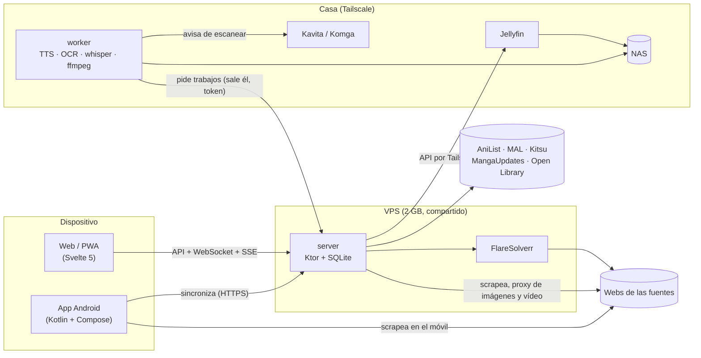

# Arquitectura de Yomukai

Yomukai es un lector y visor de manga, manhwa, manhua, cómics, novelas y anime para un grupo de amigos. Tiene tres sitios donde se ejecuta código:

- **el VPS**: ligero, siempre encendido;
- **el worker de casa**: lo pesado, a veces apagado;
- **el dispositivo**: el móvil o el navegador, que hacen lo que pueden en local.

## Módulos

| Módulo | Qué es | Notas |
|---|---|---|
| `shared/` | Kotlin puro: fuentes (scrapers y fuentes declarativas en JSON firmado), metadatos, búsqueda inteligente, modelo de obra, lógica de salas, OCR, FSRS, temas, nombres de Jellyfin, i18n | La usan la app, el servidor y el worker. Todo lo testeable vive aquí, con tests sobre HTML/JSON real en `test/resources`. |
| `app/` | App Android (Compose, Room, Media3, WorkManager, Tor) | Funciona sola (las fuentes corren en el móvil) y, si se conecta, sincroniza con el servidor. |
| `server/` | Ktor + SQLite: API, cuentas, invitados, proxy de imágenes y vídeo, salas (WebSocket), avisos (SSE, ntfy, Discord), foro, logros, cola de trabajos, integraciones | Migraciones numeradas en `Migrations.kt`; interruptores de admin en `Features.kt`. |
| `web/` | SPA instalable (Svelte 5 runes), servida por el servidor | Código partido por páginas; CSP estricta sin scripts en línea. |
| `worker/` | Trabajos pesados en casa: voces (Pocket TTS), OCR (Tesseract), traducción (LibreTranslate), subtítulos (whisper.cpp), huellas de audio (Chromaprint), descargas a Jellyfin (ffmpeg), CBZ | Se conecta él al servidor; prioridad baja (`nice`/`ionice`), se aparta si la máquina va cargada. |
| `sources/` | Fuentes declarativas en JSON | Se firman con Ed25519 en un paquete que el servidor y la app aceptan solo con firma válida. |

## Flujos principales

**La obra, no la fuente.** Cada resultado de una fuente se une a una obra:
- por su id de AniList/MAL si se conoce;
- si no, por nombre, con `TitleMatcher` y títulos alternativos.

Funciona así:
- **Búsqueda y novedades**: muestran una tarjeta por obra (`WorkGrouper`).
- **Capítulos**: se juntan de todas las fuentes (`ChapterMerge`), por idioma preferido, luego fuente favorita y luego la que más tiene. Jellyfin va primero si la tiene.
- **Progreso**: lo leído en una fuente cuenta en todas (`WorkProgress`).

**Lo pesado.** El servidor encola el trabajo (`Jobs.kt`: prioridades, deduplicación, reintentos, caducidad) y un worker lo recoge. El resultado (audio, cajas de OCR, subtítulos, huellas) se guarda en una caché de disco con tope (LRU) y se comparte entre usuarios. Sin worker, cada función se degrada:
- las voces salen del dispositivo o de Piper;
- el opening se salta con +85 s;
- el resto se muestra como «no disponible».

**Vídeo.** El servidor resuelve los servidores de cada episodio:
- con los extractores en Kotlin;
- o con yt-dlp, solo para sitios conocidos e IPs públicas.

Lo directo pasa por `/api/stream`, que soporta Range y HLS y cuenta el ancho de banda con un tope mensual. Lo del NAS pasa por `/api/jellyfin/stream`, con la clave solo en una cabecera.

**Salas.** Un WebSocket por sala. El anfitrión manda y el servidor marca el reloj. La corrección de deriva (`PartySync`, en `shared`) salta si el desfase pasa de 2 s y ajusta la velocidad al 0,95x o 1,05x entre 0,3 y 2 s. Cada cliente reproduce su propio vídeo.

**Fuentes que se rompen.** Un canario (cron en el VPS) prueba cada fuente. Si falla un paso crítico la fuente se marca como degradada y se oculta sola, y vuelve cuando funciona. Arreglarla es editar su JSON y firmar el paquete; el servidor y la app lo descargan en 6 horas como mucho. La auto-reparación opcional (en el worker) propone un PR y nunca lo fusiona.

**Jellyfin.** El VPS habla con Jellyfin por Tailscale. La biblioteca entra como una fuente más, con la insignia «en tu NAS». El progreso va en los dos sentidos con el usuario emparejado. Las descargas y los CBZ los escribe el worker en el NAS, y las obras seguidas se descargan solas cada 3 horas.

## Seguridad (resumen)

- Sesiones con cookie HttpOnly/SameSite, guardadas como hash; 2FA TOTP opcional; bloqueo progresivo de login; límites por usuario y por conexión.
- Autorización en cada ruta: admin bajo `/api/admin` con auditoría; invitados fuera de todo lo social y del NAS (`GuestsOffNas`); worker solo con su token.
- Nada de `{@html}` con datos de usuario (markdown propio, saneado); el HTML de las webs es un dato y nunca una instrucción; imágenes re-dibujadas al subirlas; CSP estricta.
- Claves de Jellyfin y Kavita/Komga cifradas con el secreto del servidor; nunca llegan a los clientes.
- Fuentes de terceros solo como JSON firmado; nunca código descargado.

## Dónde mirar

- Estado del trabajo y siguiente paso: [`TRABAJO.md`](TRABAJO.md). Encargo completo: [`docs/ENCARGO.md`](docs/ENCARGO.md).
- Instalar (tres formas, Tailscale, variables): [`docs/INSTALACION.md`](docs/INSTALACION.md). VPS pequeño: [`docs/VPS.md`](docs/VPS.md).
- Formato de las fuentes: [`sources/README.md`](sources/README.md). Voces: [`docs/VOCES.md`](docs/VOCES.md).
